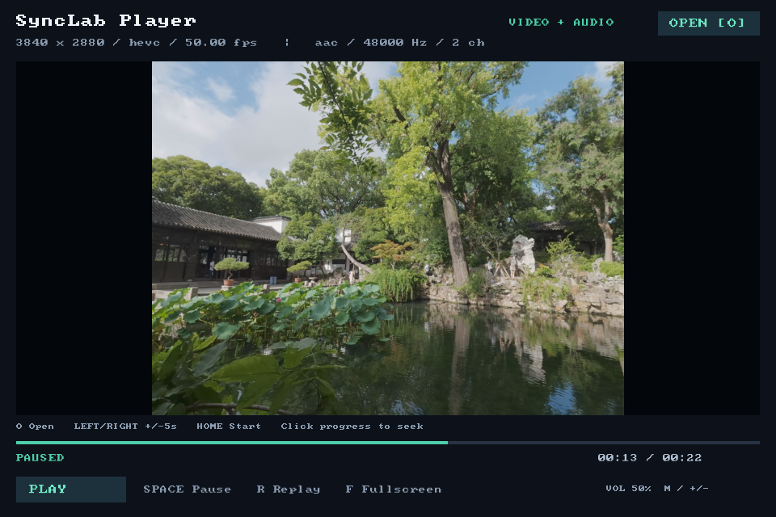

# SyncLab Player

一个面向 Windows 的简易本地音视频播放器，使用 C++17、FFmpeg 和 SDL3 实现。



## 功能

- 支持本地音视频、纯视频和纯音频文件
- FFmpeg 解复用与音视频解码
- 独立的解复用、视频解码和音频解码线程
- 按条目数量与字节数双重限流的 Packet/Frame 队列
- 音频统一重采样为 48 kHz、双声道、S16 PCM，并通过 SDL3 输出
- 视频按比例缩放渲染，以音频时钟为主时钟进行同步
- 支持暂停、重播、全屏、静音、音量调节和本地文件拖放
- 支持键盘与进度条定位；D3D11VA 可用时自动启用硬件解码
- 提供媒体信息、Packet 预览和运行时跟踪入口

## 运行环境

- Windows 10/11 x64
- CMake 3.20 或更高版本
- 支持 C++17 的 MinGW-w64 工具链
- FFmpeg 8.x 共享开发包
- SDL 3.4.16 MinGW x64 开发包

第三方开发包和运行时 DLL 不包含在仓库中。默认目录结构如下：

```text
third_party/
├── ffmpeg/
│   ├── bin/
│   ├── include/
│   └── lib/
└── SDL3/
    └── x86_64-w64-mingw32/
        ├── bin/
        ├── include/
        └── lib/
```

FFmpeg 目录需要同时包含 `avutil`、`avformat`、`avcodec`、`swscale` 和 `swresample`。CMake 会在构建后把所需 DLL 复制到可执行文件目录。

## 构建

```powershell
cmake -S . -B build -G Ninja -DCMAKE_BUILD_TYPE=Debug
cmake --build build
ctest --test-dir build --output-on-failure
```

如果 CMake 无法自动选择编译器，可追加：

```powershell
-DCMAKE_CXX_COMPILER='C:\path\to\mingw64\bin\g++.exe'
```

## 使用

直接打开播放器：

```powershell
.\build\synclab-player.exe
```

播放指定文件：

```powershell
.\build\synclab-player.exe --play 'C:\path\to\media.mp4'
```

播放结束后自动退出：

```powershell
.\build\synclab-player.exe --play 'C:\path\to\media.mp4' --auto-exit
```

查看媒体信息或前 20 个 Packet：

```powershell
.\build\synclab-player.exe --probe 'C:\path\to\media.mp4'
.\build\synclab-player.exe --packets 'C:\path\to\media.mp4'
```

设置 `SYNCLAB_TRACE=1` 可每秒输出队列、时钟、解码帧和音频断供统计。设置 `SYNCLAB_HWACCEL=off` 可关闭 D3D11VA，强制使用软件解码。

## 操作

| 操作 | 按键或鼠标 |
| --- | --- |
| 打开文件 | `O`、点击 `OPEN`，或拖入文件 |
| 暂停/继续 | `Space` 或底部按钮 |
| 前后定位 5 秒 | `Left` / `Right` |
| 回到开头 | `Home` |
| 指定位置 | 点击进度条 |
| 重新播放 | `R` |
| 全屏 | `F` |
| 静音 | `M` |
| 调节音量 | `+` / `-` |
| 退出 | `Esc` 或关闭窗口 |

## 架构

```text
                    ┌─> Video Packet Queue ─> Video Decoder ─> Frame Queue ─> SDL Renderer
File -> FFmpeg Demuxer
                    └─> Audio Packet Queue ─> Audio Decoder ─> PCM Queue ───> SDL Audio
```

`MediaPipeline` 管理工作线程和有界队列。Packet 与 AVFrame 使用 RAII 管理并通过移动语义转移所有权。队列在正常结束时关闭，在取消或错误时清空并唤醒等待线程，避免退出阶段的背压死锁。

有音频时，播放器根据 SDL 已消费的 PCM 估算音频时钟，并以此决定视频帧显示、等待或丢弃；纯视频使用单调时钟。定位操作会停止当前管线，从目标附近重新解复用，并裁剪目标时间之前的音视频输出。

D3D11VA 路径会将硬件帧下载到系统内存，再转换为 SDL 纹理，因此当前实现不是零拷贝渲染。

## 测试

CTest 覆盖有界队列、播放时钟、视频调度、定位计算、音视频解码管线、重采样和 SDL 音频断供。测试媒体由 FFmpeg 的 `lavfi` 在构建目录中生成，不提交媒体文件。

`tests/` 还包含 Windows 窗口集成检查脚本，用于验证播放、文件打开、拖放、暂停、定位、重播、音频输出与高帧率视频。

## 限制

- 当前仅支持 Windows；本地文件选择器使用 Win32 API
- 进度条只支持点击定位，不支持拖动预览
- 不支持字幕、播放列表、网络流专用重连、HDR 色彩管理和零拷贝硬件渲染
- 实际格式与编解码器支持范围取决于使用的 FFmpeg 构建

## 开源协议与第三方软件

项目源码和文档采用 [MIT License](LICENSE)。预览图来自项目维护者的原创影像，不包含在 MIT 授权范围内，详见[媒体资源声明](docs/assets/ASSET_NOTICE.md)。FFmpeg 与 SDL3 均为独立的第三方项目，不属于本项目，也不随源码仓库分发。完整说明见 [THIRD_PARTY_NOTICES.md](THIRD_PARTY_NOTICES.md)。

FFmpeg 的默认许可为 LGPL 2.1 或更高版本；如果所选构建启用了 GPL 组件，则该 FFmpeg 构建适用 GPL。发布包含 FFmpeg DLL 的二进制包前，请核对具体构建的配置和许可证，并履行相应条款。

## 致谢

感谢 [FFmpeg](https://ffmpeg.org/) 项目提供多媒体框架，感谢 [SDL](https://www.libsdl.org/) 项目提供跨平台媒体与窗口接口。播放器的线程、时钟和同步设计参考了 FFmpeg 的 `ffplay` 示例实现。
